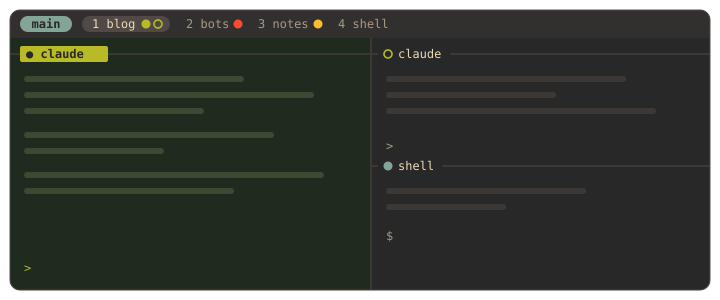
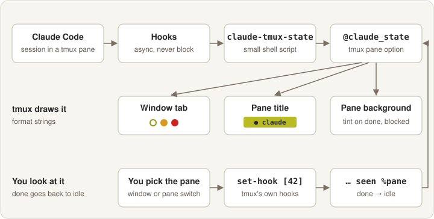
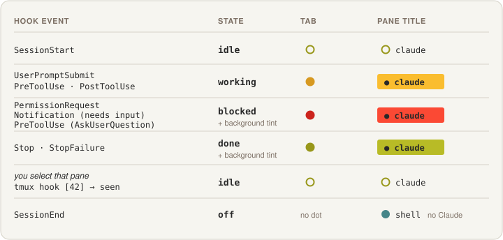

# tmux

**Claude Code 세션이 지금 무엇을 하는지 한눈에 보이는 tmux 설정.** Catppuccin(Mocha) 테마 위에, Claude Code 훅이 pane 마다 상태 동그라미를 그립니다.



tmux 안에 Claude Code 세션을 여러 개 띄워 두면 탭이 다 똑같아 보여서, 어느 세션이 일하는 중인지, 어느 세션이 내 답을 기다리는지 알 수 없습니다. 이 설정은 그 상태를 창 탭·pane 제목 줄·pane 배경에 색으로 보여 줍니다.

---

## 무엇이 보이나

| 상태 | 창 탭 | pane 제목 줄 | 언제 |
|---|---|---|---|
| idle | ○ 초록 | ○ 이름 | 세션이 떠 있고 할 일이 없음 |
| working | ● 노랑 | 노랑 띠 | 프롬프트를 보냈거나 도구를 쓰는 중 |
| blocked | ● 빨강 | 빨강 띠 + 옅은 배경 | 권한 요청·선택지 질문 등 **내 답을 기다림** |
| done | ● 초록 | 초록 띠 + 옅은 배경 | 끝났는데 아직 안 봄. 그 pane 을 선택하면 idle 로 |

- **창 탭**: 창 이름 뒤에 pane 마다 동그라미 하나. 한 창에 Claude 가 셋이면 셋.
- **pane 제목 줄**: 상태 띠 옆에 **컨텍스트가 찬 정도**(예: `43%`)를 보여 줍니다. 70% 부터 노랑, 85% 부터 빨강.
- **상태줄 오른쪽**: [ccswitch](https://github.com/sglim/ccswitch) 계정 사용량(깔려 있을 때만) · CPU · RAM + 메모리 압력 점(macOS) · 디스크 · 호스트.
- **iTerm2 배지**: `prefix + B` 로 pane 에 이름표를 붙이면 iTerm2 배경 워터마크로도 보입니다.

## 어떻게 동작하나

Claude Code 훅이 작은 셸 스크립트(`claude-tmux-state`)를 부르고, 스크립트는 자기 pane 의 tmux 옵션 `@claude_state` 에 상태를 적습니다. 나머지는 tmux 포맷 문자열이 그립니다. 훅은 비동기라 Claude 는 기다리지 않습니다.





- **done 은 볼 때까지 켜 둡니다.** 창·세션·pane 을 바꾸면 tmux 자체 훅이 `claude-tmux-state seen` 을 불러 그 pane 의 done 을 idle 로 바꿉니다. 끝날 때 이미 그 pane 을 보고 있으면 바로 idle 입니다.
- **선택지 질문도 blocked 로 봅니다.** 권한 우회(bypass) 모드에선 선택지 질문(AskUserQuestion)이 권한 요청을 보내지 않아서, 스크립트가 도구 이름을 보고 blocked 로 바꿉니다.
- **컨텍스트 %** 는 Claude Code 상태줄 스크립트(`claude-statusline`)가 pane 옵션 `@claude_ctx` 에 적습니다.


---

## 요구 사항

| | |
|---|---|
| tmux | 3.3 이상 (`allow-passthrough`, `extended-keys`) |
| 도구 | `git`, `jq`(컨텍스트 % 와 `--claude` 설치에 필요) |
| 글꼴 | Nerd Font 권장(Catppuccin 둥근 탭) |
| 선택 | [Claude Code](https://docs.claude.com/en/docs/claude-code), [ccswitch](https://github.com/sglim/ccswitch), iTerm2(배지) |

macOS 기준입니다. 복사는 `pbcopy`, 메모리 압력 점은 macOS `sysctl` 을 씁니다. Linux 에서도 tmux 설정 자체는 읽히지만 이 두 가지는 동작하지 않습니다.

## 설치

```bash
git clone https://github.com/sglim/tmux.git ~/repos/tmux
cd ~/repos/tmux
./install.sh            # ~/.tmux.conf · ~/.local/bin 스크립트 링크 + TPM·플러그인
./install.sh --claude   # + Claude Code 훅·상태줄을 ~/.claude/settings.json 에 합침
```

- 이미 있던 `~/.tmux.conf` 나 같은 이름의 스크립트는 지우지 않고 `<파일>.bak.<시각>` 으로 옮깁니다. 다시 돌려도 안전합니다.
- `--claude` 는 `~/.claude/settings.json` 을 먼저 백업하고, 기존 훅은 그대로 둔 채 이 저장소의 훅만 붙입니다(여러 번 돌려도 하나만 남습니다). 상태줄은 비어 있을 때만 넣습니다.
- 넣을 훅과 상태줄은 [`claude/settings.json`](claude/settings.json) 에 있습니다. 손으로 합쳐도 됩니다.
- 플러그인을 나중에 깔려면 `--no-plugins` 로 설치한 뒤 tmux 안에서 `prefix + I`.

지우기: `./install.sh --uninstall` — 이 저장소를 가리키는 링크만 지웁니다. 예전 설정은 `.bak.*` 파일로 되돌리세요.

## 키 바인딩

prefix 는 `Ctrl-a` 입니다.

| 키 | 동작 |
|---|---|
| `prefix` `\|` / `-` | 좌우 / 위아래로 나누기 |
| `prefix` `h` `j` `k` `l` | pane 이동 |
| `Alt` + `h` `j` `k` `l` 또는 방향키 | pane 이동 (prefix 없이) |
| `prefix` `H` `J` `K` `L` | pane 크기 5칸씩 |
| `Shift` + `←` `→` | 이전 / 다음 창 |
| `prefix` `<` / `>` | 창을 왼쪽 / 오른쪽으로 한 칸 옮기기 (연타 가능) |
| `prefix` `y` | 창 안 모든 pane 에 동시 입력 켜기 / 끄기 |
| `prefix` `B` | pane 이름표 붙이기 (iTerm2 배지 동기화) · `prefix` `Alt-B` 로 지우기 |
| `prefix` `r` | 설정 다시 읽기 |
| 마우스 드래그 · 더블클릭 · `y` | 선택하면 바로 클립보드로 |

세션은 [tmux-resurrect](https://github.com/tmux-plugins/tmux-resurrect) · [tmux-continuum](https://github.com/tmux-plugins/tmux-continuum) 이 5분마다 저장하고 tmux 를 다시 켜면 복원합니다.

## 파일

| 경로 | 역할 |
|---|---|
| `tmux.conf` | tmux 설정 본체 |
| `bin/claude-tmux-state` | Claude 훅 → pane 상태(`@claude_state`)와 배경색 |
| `bin/claude-statusline` | Claude Code 상태줄(모델 · 폴더·브랜치 · 컨텍스트) + pane 의 `@claude_ctx` |
| `bin/tmux-ccswitch` | ccswitch 사용량 칸(ccswitch 가 없으면 빈 출력) |
| `bin/tmux-mem-pressure` | macOS 메모리 압력 색점 |
| `bin/tmux-disk-usage` | 디스크 사용률(APFS 데이터 볼륨 기준) |
| `bin/tmux-badge-prompt`, `bin/tmux-badge-sync` | pane 이름표 ↔ iTerm2 배지 |
| `claude/settings.json` | Claude Code 에 넣을 훅·상태줄 |

## 알아 둘 점

- **Esc 로 멈추면 노랑이 남습니다.** Esc 로 중단하면 Stop 훅이 오지 않습니다. 다음 프롬프트를 보내면 풀립니다.
- **훅 순서.** tmux 는 번호 없이 `set-hook` 을 하면 그 훅 목록을 통째로 비웁니다. 그래서 이 설정의 Claude 용 훅은 고정 번호 `[42]` 를 쓰고 파일 맨 끝에 둡니다. 다른 설정을 덧붙일 때는 그 아래에 번호 없는 `set-hook` 을 두지 마세요.
- **SSH 로 띄운 tmux.** macOS 에서 SSH 로 tmux 서버를 띄우면 키체인이 잠겨 그 안의 Claude 가 로그인하지 못할 수 있습니다. 데스크톱 쪽에서 tmux 를 띄우세요.

## 보안에 관해 알아 둘 점

쓰기 편하게 켜 둔 설정 중에는 보안과 맞바꾼 것이 있습니다. 환경에 맞게 고르세요.

| 설정 | 무엇을 허용하나 | 끄려면 |
|---|---|---|
| `allow-passthrough on` | pane 안 프로그램이 tmux 를 거치지 않고 터미널(iTerm2)에 제어 코드를 보낼 수 있습니다(보이는 pane 만). 터미널 알림·이미지 표시에 필요합니다. 이 설정의 배지 기능은 이 옵션 없이도 동작합니다 | `off` |
| `set-clipboard on` | pane 안 프로그램이 OSC 52 로 클립보드를 바꿀 수 있습니다. ssh 너머에서 복사할 때 편하지만, 믿지 않는 출력을 띄운 뒤에는 붙여넣기 전에 확인하세요 | `external` |
| `@resurrect-capture-pane-contents on` | 5분마다 모든 pane 의 **화면 내용**이 `~/.local/share/tmux/resurrect/` 에 평문으로 저장됩니다. 화면에 비밀번호·토큰·고객 데이터를 띄우는 환경이면 끄고, 그 폴더는 `chmod -R go-rwx` 로 막아 두세요 | `off` |
| `@resurrect-processes` 의 `ssh` `psql` `mysql` | 이 명령들의 **명령줄 전체**가 저장되고 복원 때 다시 실행됩니다. 명령줄에 비밀번호를 넣지 마세요(환경 변수·설정 파일 사용) | 목록에서 빼기 |
| TPM 플러그인 | 플러그인은 GitHub 에서 받아 실행하는 셸 스크립트입니다. catppuccin 만 버전을 고정했고 나머지는 최신을 받습니다 | `'tmux-plugins/tmux-resurrect#<태그>'` 처럼 고정 |

이 저장소의 스크립트는 네트워크를 쓰지 않습니다. Claude 훅이 부르는 `claude-tmux-state` 는 tmux 옵션만 바꾸고, 상태줄 스크립트는 저장소 이름에 섞인 제어 문자를 버린 뒤 출력합니다. `install.sh --claude` 는 `settings.json` 을 원래 권한 그대로 백업하고, 합치다 실패하면 원본을 건드리지 않습니다.

## 고마운 것

- 에이전트마다 창 이름 옆에 점을 찍는 아이디어는 코딩 에이전트용 멀티플렉서 herdr 에서 가져왔습니다.
- 테마는 [catppuccin/tmux](https://github.com/catppuccin/tmux).

## 라이선스

MIT
